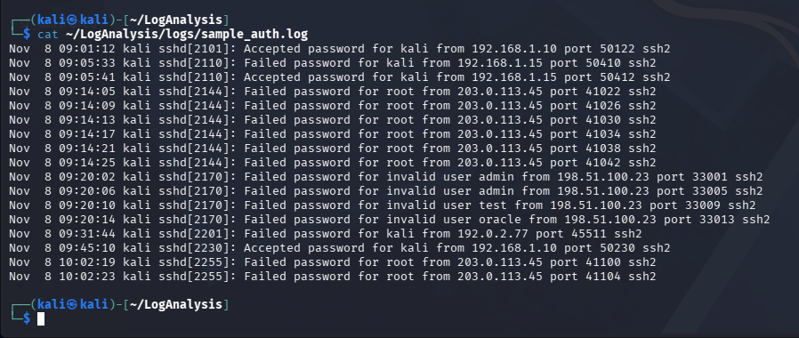
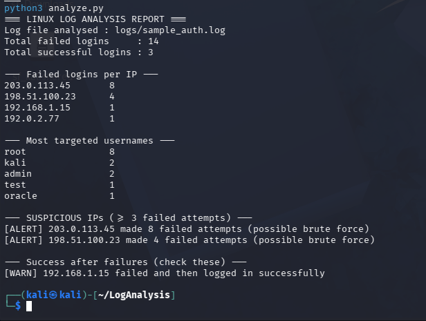
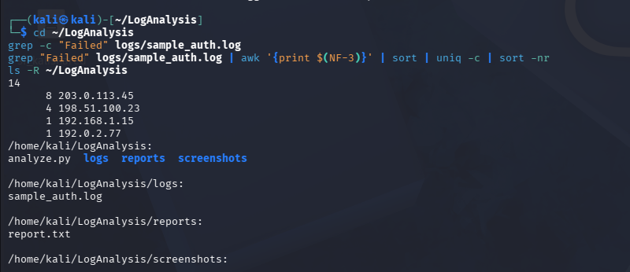
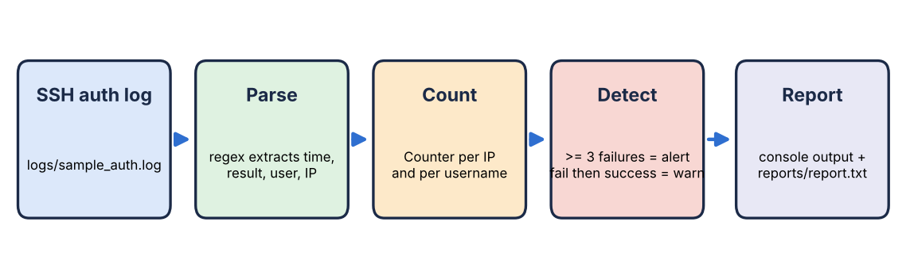

# Linux Log Analysis

- **Author:** Muhammad Hasnain
- **Internship:** Zynvex Internship (Cybersecurity) | **Project #129**
- **Environment:** Kali Linux (VirtualBox), Python 3

A Python tool that analyzes Linux SSH authentication logs, counts failed and successful logins, and flags IP addresses that look like brute-force attacks.

---

## 1. Project Overview and Objectives

Log files record everything that happens on a system, and analyzing them is a daily task of a SOC analyst. Attackers constantly try to guess SSH passwords, and every attempt is written to the authentication log. Reading these logs by hand is slow, so this project automates the first level of analysis.

**Objectives**
- Understand the structure of Linux SSH authentication logs
- Parse logs using regular expressions in Python
- Detect brute-force behavior and flag suspicious IP addresses
- Verify the results with Linux command-line tools
- Produce a clear text report

## 2. Features and Technologies Used

**Features**
- Total failed and successful login counts
- Failed logins per source IP (ranked)
- Most targeted usernames (for example `root`)
- Suspicious IP detection (default threshold: 3 or more failed attempts)
- Warning when an IP fails and then logs in successfully
- Report saved to `report.txt`

**Technologies**
- Python 3 (`re` and `collections` modules, no external libraries)
- Bash tools for verification: `grep`, `awk`, `sort`, `uniq`
- Kali Linux

## 3. Project Structure

```
LinuxLogAnalysis/
├── analyze.py              # main script
├── sample_auth.log         # sample SSH authentication log (17 entries)
├── report.txt              # generated report
├── 01_sample_log.png       # screenshot: sample log
├── 02_script_output.png    # screenshot: script output
├── 03_verification.png     # screenshot: manual verification
├── workflow.png            # workflow diagram
├── Project_Report.pdf      # full project report
└── README.md
```

## 4. Installation and Setup

Requirements: Linux (tested on Kali Linux) and Python 3. No extra packages are needed.

```bash
git clone https://github.com/muhammadhasnainlakhai/LinuxLogAnalysis.git
cd LinuxLogAnalysis
python3 --version
```

## 5. Usage

Run the script from the project folder:

```bash
python3 analyze.py
```

To analyze another log file, change the `LOG` variable at the top of `analyze.py`. The threshold for flagging an IP can be changed with the `THRESHOLD` variable.

**Manual verification with Linux commands**

```bash
grep -c "Failed" sample_auth.log
grep "Failed" sample_auth.log | awk '{print $(NF-3)}' | sort | uniq -c | sort -nr
```

**Screenshots**

Sample log:


Script output:


Manual verification:


## 6. System Workflow / Architecture



1. The script reads the SSH authentication log line by line.
2. A regular expression extracts the time, result (Failed or Accepted), username, and source IP.
3. Counters store failures per IP and per username, and the result history of each IP.
4. Detection rules flag IPs with 3 or more failures and IPs that fail and then succeed.
5. The report is printed on screen and saved to `report.txt`.

## 7. Testing and Results

The tool was tested on a sample log of 17 entries and the results were verified manually with `grep`, `awk`, `sort`, and `uniq`.

| Metric | Script result | Manual check |
|---|---|---|
| Failed logins | 14 | 14 |
| Successful logins | 3 | - |
| 203.0.113.45 | 8 failed (flagged) | 8 |
| 198.51.100.23 | 4 failed (flagged) | 4 |
| 192.168.1.15 | 1 failed, then success (warning) | 1 |
| 192.0.2.77 | 1 failed | 1 |

**Findings**
- `203.0.113.45` attacked the `root` account repeatedly and returned later (persistent brute force).
- `198.51.100.23` tried the invalid usernames `admin`, `test`, and `oracle` (dictionary attack).
- `192.168.1.15` is most likely a typing mistake by an internal user.

The IP addresses used in the sample belong to reserved documentation ranges (RFC 5737), so no real systems are involved.

## 8. Challenges and Future Improvements

**Challenges**
- Modern Kali Linux does not create `/var/log/auth.log` by default (SSH events go to the systemd journal). I solved this by creating a sample log in the standard sshd format.
- Writing a regular expression that also handles the "invalid user" lines.

**Future improvements**
- Read real logs (for example `journalctl -u ssh`)
- Time-window detection (for example 5 failures in 1 minute)
- GeoIP lookup and threat intelligence checks (VirusTotal, AbuseIPDB)
- CSV export, charts, email alerts, and automatic IP blocking

## 9. Conclusion

The project shows how Python and basic Linux tools can turn raw authentication logs into useful security information. The script correctly detected two brute-force sources, identified the most targeted account, and warned about a failure-then-success pattern, and its results matched the manual verification. It builds practical SOC skills in log analysis, regular expressions, and incident detection.

## 10. References

1. OpenSSH, sshd_config manual page: https://man.openbsd.org/sshd_config
2. MITRE ATT&CK, Brute Force (T1110): https://attack.mitre.org/techniques/T1110/
3. Python documentation, re module: https://docs.python.org/3/library/re.html
4. IETF, RFC 5737: https://www.rfc-editor.org/rfc/rfc5737
5. Wazuh documentation: https://documentation.wazuh.com
